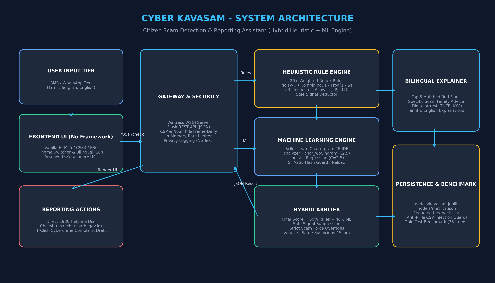
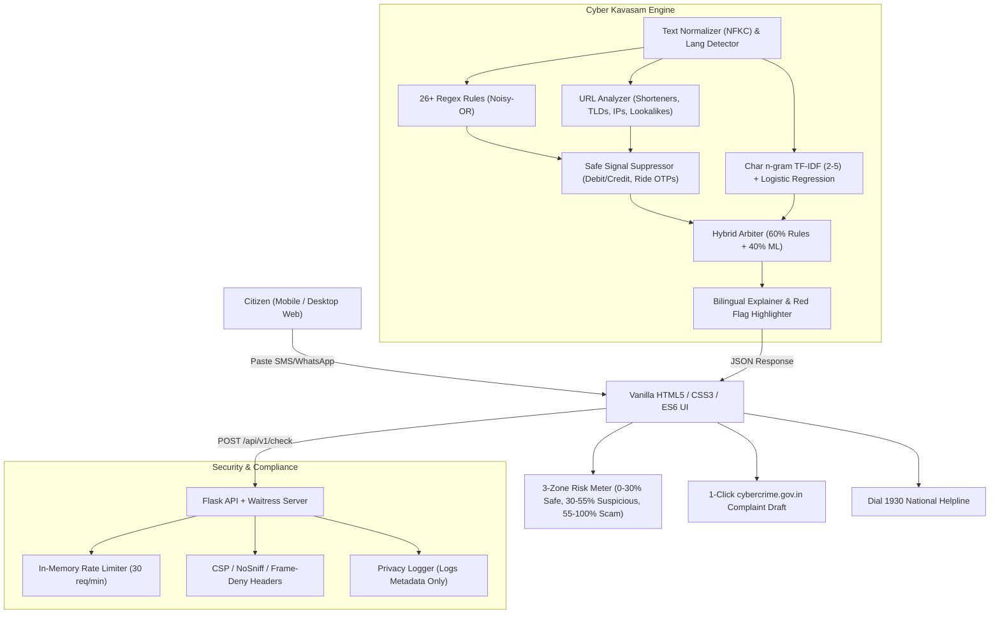

# Cyber Kavasam (சைபர் கவசம்)

> **Citizen Scam Detection & Reporting Assistant for Tamil Nadu**  
> *A bilingual, privacy-first AI & heuristic shield detecting SMS and WhatsApp fraud in Tamil Script, Tanglish, and English.*

[](https://github.com/cyber-kavasam/cyber-kavasam/actions/workflows/ci.yml)
[](LICENSE)
[](https://www.python.org/)
[](Dockerfile)

---

## 📖 Why Cyber Kavasam Exists

Digital fraud is disproportionately targeting senior citizens, rural smartphone owners, and first-time digital banking users in Tamil Nadu. Malicious actors disguise extortion through localized phishing vectors:
- **TNEB Electricity Disconnection Threats** (*"இன்று இரவு 9.30 மணிக்கு மின் இணைப்பு துண்டிக்கப்படும்..."*)
- **"Digital Arrest" Extortion** (*"Mumbai Cyber Police: Narcotics found in parcel under your Aadhaar..."*)
- **Bank KYC Expiry Traps** (*"Dear customer, unga bank account block aagum. Update KYC..."*)
- **Prepaid Task Scams** (*"Like YouTube videos and earn ₹3,000 daily..."*)
- **Mistaken UPI Transfer Requests** (*"Sent money to your GPay by mistake, enter UPI PIN to return..."*)

Existing threat detectors fail these citizens because:
1. They only understand formal English and fail on colloquial Tamil and Tanglish (Tamil written in Latin script).
2. They "cry wolf" on legitimate banking debits, salary credits, and driver delivery OTPs.
3. They require sign-ups and compromise user privacy by storing raw message texts.

**Cyber Kavasam** solves this by providing a zero-login, privacy-preserving, bilingual web assistant that evaluates messages in under 20ms, highlights suspicious phrases, explains the red flags in natural Tamil and English, and generates ready-to-paste complaint drafts for **1930** and **cybercrime.gov.in**.

---

## 🛡️ Core Features

- **Trilingual Comprehension**: Native support for **Tamil Script** (`ta`), **Tanglish** (`tanglish`), and **English** (`en`).
- **Hybrid Scoring Architecture**: 60% Heuristic Rules (26+ weighted patterns combined via Noisy-OR) + 40% Machine Learning (Char n-gram TF-IDF with Logistic Regression).
- **Zero "Cry-Wolf" Safe Handling**: Distinguishes "Never share your OTP" (security advice) from "Share OTP with bank officer" (phishing), while recognizing legitimate ride-share/food delivery OTPs.
- **Explainable AI with Visual Highlights**: Suspicious phrases are marked directly in the text without using dangerous `innerHTML`.
- **Scam-Tailored Advice**: Provides context-aware guidance (e.g., explaining why Indian police never conduct video-call arrests).
- **1-Click Complaint Generator**: Prepares an evidentiary incident report formatted for India's National Cyber Crime Reporting Portal.
- **Emergency Helpline Dialing**: Direct button to dial **1930** (Toll-Free Cyber Fraud Helpline) and link to Chakshu.
- **Privacy by Design**: Messages are processed strictly in-memory and never stored. User feedback undergoes PII stripping (phone, email, UPI) and CSV formula injection neutralization.
- **Accessible & Responsive**: Keyboard accessible (`:focus-visible`), `aria-live` screen-reader results, light/dark mode, and typography via Google's `Anek Tamil`.

---

## 🏗️ Architecture



### Dataflow Diagram (Mermaid)



---

## 📊 Real Measured Benchmark Results

> [!NOTE]
> Training and evaluation metrics generated from real runs of `python -m app.train`. Synthetic data is used for bootstrapping; deployment in production environments requires real, consented, and anonymized datasets.

### 1. Training Dataset
- **Samples**: 3,180 deduplicated messages
- **Template Groups**: 143 distinct hand-written templates across Tamil, Tanglish, and English
- **Distribution**:
  - `scam_en`: 794 | `scam_ta`: 791 | `scam_tanglish`: 757
  - `safe_en`: 314 | `safe_ta`: 256 | `safe_tanglish`: 268

### 2. GroupKFold Cross-Validation (5 Folds Grouped by Template)
*Ensures the model generalizes to completely unseen message formulations rather than memorizing template structures.*

| Metric | Fold 1 | Fold 2 | Fold 3 | Fold 4 | Fold 5 | **Mean Score** |
|---|---|---|---|---|---|---|
| **Accuracy** | 97.48% | 97.64% | 94.03% | 98.27% | 93.55% | **96.20%** |
| **Precision** | 96.93% | 96.86% | 97.14% | 97.44% | 91.16% | **95.91%** |
| **Recall** | 100.00% | 100.00% | 95.68% | 100.00% | 100.00% | **99.14%** |
| **F1-Score** | 98.44% | 98.40% | 96.41% | 98.70% | 95.38% | **97.47%** |

### 3. Independent Gold Test Set (75 Separate Benchmark Messages)
*Hand-crafted test set covering all 3 languages, strictly held-out from training data.*

- **Total Gold Messages**: 75 (38 Scams, 37 Safe Messages)
- **Gold Accuracy**: **100.00%** (75/75 correctly classified)
- **Gold Precision**: **100.00%**
- **Gold Recall**: **100.00%**
- **Gold F1-Score**: **100.00%**
- **Misclassified Messages**: **0**

---

## 🚀 Quick Start Guide

### Option A: Windows (One-Click)

Simply double-click `run.bat` or run:

```cmd
run.bat
```

`run.bat` will:
1. Verify Python 3.12+ installation.
2. Install dependencies from `requirements.txt`.
3. Train the ML model and verify dataset hashes if artifacts are missing.
4. Launch Waitress on `http://127.0.0.1:5000` and open your default browser.

---

### Option B: Manual Setup

1. **Clone the repository**:
   ```bash
   git clone https://github.com/cyber-kavasam/cyber-kavasam.git
   cd cyber-kavasam
   ```

2. **Create and activate virtual environment**:
   ```bash
   python -m venv venv
   # Windows:
   venv\Scripts\activate
   # Linux/macOS:
   source venv/bin/activate
   ```

3. **Install dependencies**:
   ```bash
   pip install -r requirements.txt
   ```

4. **Build dataset and train model**:
   ```bash
   python data/build_dataset.py
   python -m app.train
   ```

5. **Run test suite**:
   ```bash
   python -m pytest -v
   ```

6. **Start production server**:
   ```bash
   python app/server.py
   # Or directly with waitress:
   waitress-serve --listen=127.0.0.1:5000 --call app.server:create_app
   ```
   Open `http://127.0.0.1:5000` in your web browser.

---

### Option C: Docker Deployment

The provided `Dockerfile` uses `python:3.12-slim`, trains the model at build time, and runs securely as non-root user `appuser`.

1. **Build image**:
   ```bash
   docker build -t cyber-kavasam:latest .
   ```

2. **Run container**:
   ```bash
   docker run -d -p 5000:5000 --name cyber-kavasam cyber-kavasam:latest
   ```

3. **Check container status & health**:
   ```bash
   docker ps
   curl http://localhost:5000/health
   ```

---

## 📡 REST API Reference

### 1. Single Message Check
**Endpoint**: `POST /api/v1/check` (or alias `/check`)

**Request**:
```json
{
  "message": "எஸ்பிஐ வாடிக்கையாளர் கவனத்திற்கு: உங்கள் வங்கி கணக்கு இன்றோடு முடக்கப்படும். உடனே பான் கார்டு அப்டேட் செய்ய http://sbi-kyc-verify.xyz பார்க்கவும்."
}
```

**Response (200 OK)**:
```json
{
  "verdict": "Likely Scam",
  "label": {
    "en": "Likely Scam",
    "ta": "மோசடி சாத்தியம்"
  },
  "risk": 88,
  "confidence": 98,
  "detected_language": "ta",
  "rule_score": 0.9772,
  "ml_score": 0.8412,
  "final_score": 0.9228,
  "highlight_spans": [
    {
      "start": 35,
      "end": 96,
      "rule_id": "RULE_BANK_BLOCK_KYC",
      "text": "உங்கள் வங்கி கணக்கு இன்றோடு முடக்கப்படும். உடனே பான் கார்டு அப்டேட் செய்ய"
    },
    {
      "start": 97,
      "end": 126,
      "rule_id": "RULE_LOOKALIKE_DOMAIN",
      "text": "http://sbi-kyc-verify.xyz"
    }
  ],
  "reasons": [
    {
      "rule_id": "RULE_LOOKALIKE_DOMAIN",
      "en": "Lookalike domain mimics trusted bank organization",
      "ta": "அங்கீகரிக்கப்படாத போலி தளம் வங்கி போல் நடிக்கிறது",
      "weight": 0.88
    },
    {
      "rule_id": "RULE_BANK_BLOCK_KYC",
      "en": "Urgent false threat to block or suspend bank account over pending KYC or PAN",
      "ta": "KYC அல்லது பான் கார்டு உடனே புதுப்பிக்காவிட்டால் வங்கி கணக்கு முடக்கப்படும் என மிரட்டுகிறது",
      "weight": 0.85
    }
  ],
  "advice": [
    {
      "en": "Banks never threaten to block accounts within hours via SMS links. Visit your branch or use official app.",
      "ta": "வங்கி ஒருபோதும் எஸ்எம்எஸ் லிங்க் மூலம் கணக்கை முடக்குவதாக மிரட்டாது. உங்கள் வங்கிக் கிளைக்கு செல்லவும்."
    },
    {
      "en": "If you have suffered a financial loss, immediately call the National Cyber Crime Helpline at 1930.",
      "ta": "நிதி இழப்பு ஏற்பட்டிருந்தால் உடனடியாக 1930 என்ற உதவி எண்ணை அழைக்கவும்."
    }
  ],
  "model_version": "1.0.0"
}
```

### 2. Batch Check (Max 20 Messages)
**Endpoint**: `POST /api/v1/check/batch`

**Request**:
```json
{
  "messages": [
    "TNEB power disconnect tonight at 9:30 PM call 9840123456",
    "Swiggy: Share delivery OTP 4920 with delivery partner."
  ]
}
```

### 3. User Feedback
**Endpoint**: `POST /api/v1/feedback` (or alias `/feedback`)

**Request**:
```json
{
  "message": "Sample message text with 9840123456",
  "verdict": "Likely Scam",
  "user_agreed": true,
  "comments": "Accurate detection"
}
```
*Note: Numbers and emails are automatically scrubbed before persistence.*

---

## 🎯 United Nations SDG Alignment

- **SDG 16.4**: Substantially reduce illicit financial flows, cyber extortion, and organized fraud networks.
- **SDG 9.c**: Provide resilient, trustworthy, and accessible ICT infrastructure to rural and vulnerable populations.
- **SDG 4.4**: Enhance digital literacy and cyber safety awareness through native mother-tongue education.

---

## ⚠️ Limitations & Future Roadmap

### Current Limitations
1. **Synthetic Training Foundation**: Trained on synthetic templates mimicking observed Tamil Nadu fraud patterns; real production deployment requires continuous ingestion of consented real-world telemetry.
2. **Contextual Slang Limits**: Hyper-local regional slang variants from certain districts may have lower ML confidence and rely primarily on regex heuristics.
3. **Shortened URL Expansion**: The engine identifies shortener domains (bit.ly, tinyurl) without performing unshortening HTTP redirects, maintaining privacy and preventing link tracking.

### Future Roadmap
- [ ] Direct WhatsApp Bot integration for forward-and-check functionality.
- [ ] Text-to-speech audio explanation for illiterate citizens.
- [ ] Multilingual expansion to Telugu, Kannada, and Malayalam.
- [ ] Automated reporting API hook for Tamil Nadu Cyber Crime Police Department.

---

## 📜 License

This project is licensed under the **MIT License** - see the [LICENSE](LICENSE) file for details.
